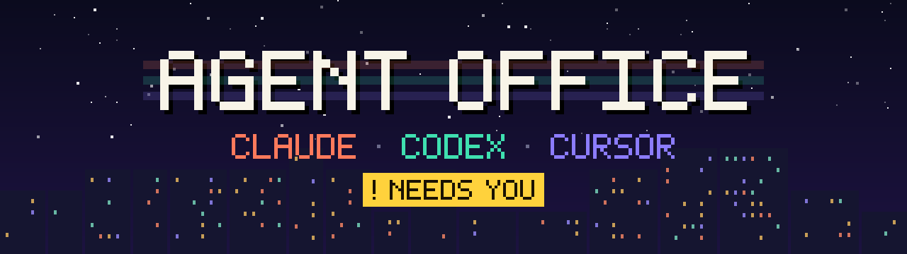
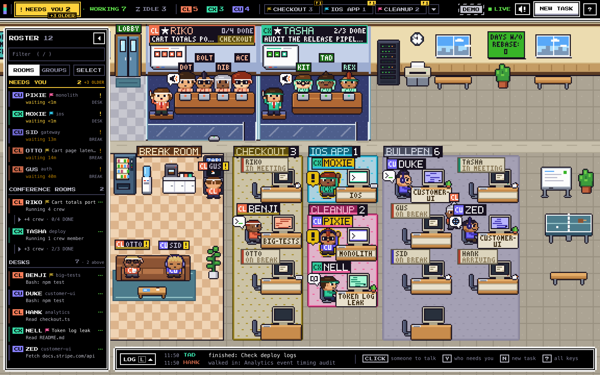
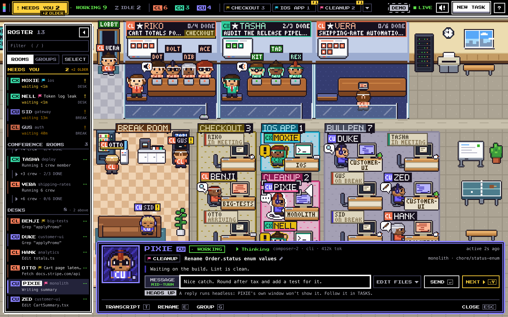
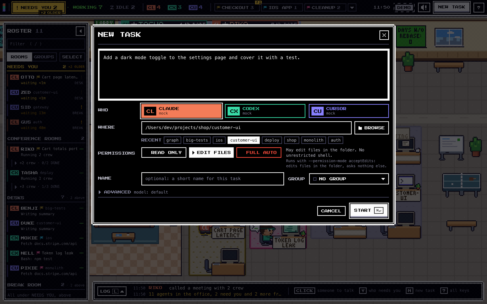
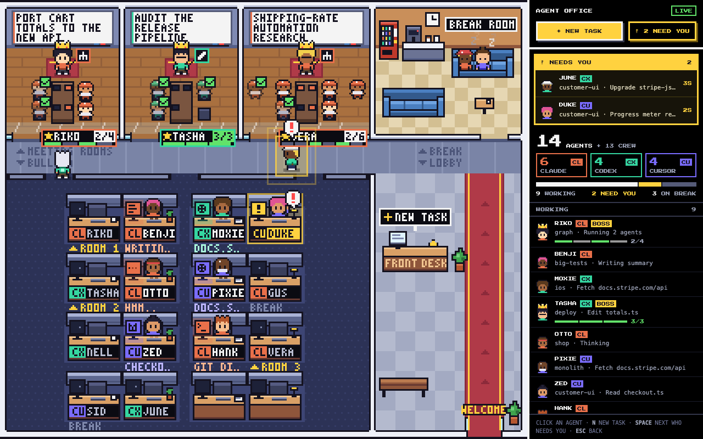
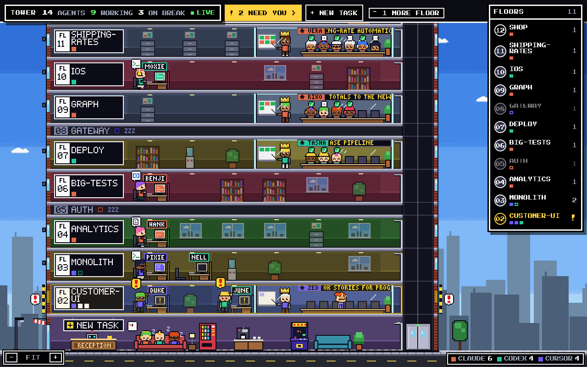
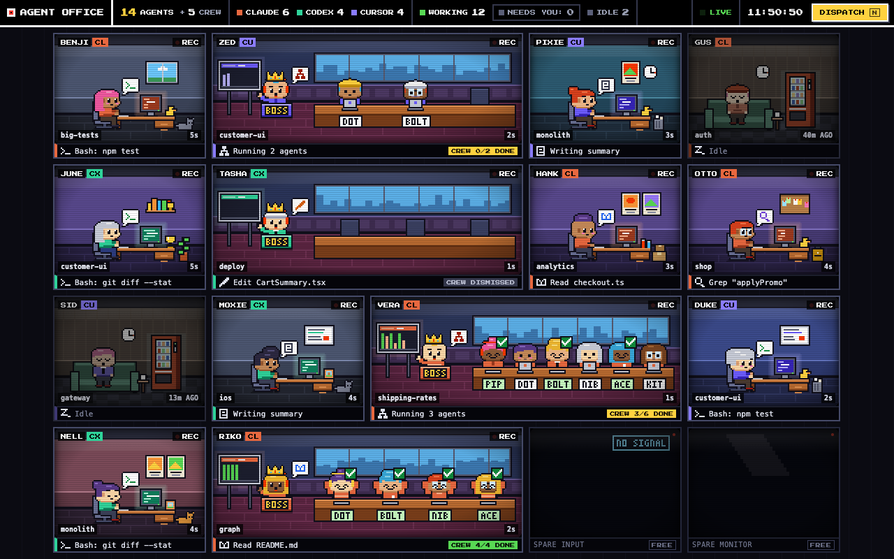
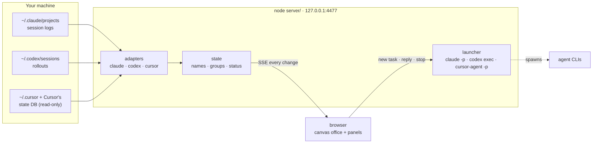

<div align="center">



### Your AI coding agents, clocked in.

A live, pixel-art office for every **Claude Code**, **Codex** and **Cursor** session running on your machine.<br>
Solo agents work at their desks. Orchestrators run meetings with their crew. The one with its hand up needs you.

<p>


</p>



</div>

---

## ▶ Press start

```bash
git clone https://github.com/comountainclimber/agent-office.git
cd agent-office
npm start            # → http://127.0.0.1:4477
```

No install step: there are no dependencies. Want to look around without any agents running?

```bash
npm run mock         # a busy demo office with 14 fake agents
```

Or open any page with `?mock=1` to get the demo straight in the browser.

---

## ★ What's on the floor

<table>
<tr>
<td width="50%" valign="top">

**🪑 Desks, pods and meeting rooms**

Every live session gets a character. A solo agent sits **alone at its own desk**. When an agent spawns subagents it walks into a **glass conference room**, takes the head of the table under a ★ banner, and its crew files in around it with ✓ marks as they finish.

Idle agents drift to the **break room**: couch, vending machine, arcade cabinet. New sessions walk in through the lobby; finished ones walk out.

</td>
<td width="50%" valign="top">

**❗ Who needs you, unmissable**

When an agent finishes its turn and is waiting on you, it turns to face you with a **hand up and a yellow "!"**. Bright yellow means "needs you" and nothing else, anywhere in the app.

Wander off for twenty minutes and it still counts: agents you haven't answered keep a quiet "!" and show up as **+N OLDER** until you look at them.

</td>
</tr>
<tr>
<td width="50%" valign="top">

**💬 Read and reply in place**

Press <kbd>Y</kbd> to jump to the next agent that needs you. Its whole last message is right there, with a reply box underneath: type, press <kbd>Enter</kbd>, done. The reply resumes that exact session headlessly.

<kbd>T</kbd> opens the transcript, with runs of tool calls folded and crew reports shown as crew reports.

</td>
<td width="50%" valign="top">

**🚀 Start tasks from the office**

Press <kbd>N</kbd>, type what you want, pick **Claude, Codex or Cursor**, a folder and how much freedom it gets (**read only / edit files / full auto**), and press <kbd>⌘</kbd><kbd>Enter</kbd>. A new hire walks in the door and gets to work.

If a CLI is signed out the menu tells you the exact command to fix it, and if a launch fails you get the real error and a one-click **RETRY**.

</td>
</tr>
<tr>
<td width="50%" valign="top">

**🏷️ Name and group your work**

<kbd>E</kbd> gives a task a short name. <kbd>G</kbd> drops it into a group, or type a new group name to create one on the spot. Groups become **colour-coded pods** of desks in the office and chips in the top bar; click one to spotlight just that group.

Give a group a folder and every agent working there joins it automatically.

</td>
<td width="50%" valign="top">

**🔊 Arcade sound cues**

Tiny synthesized chiptune blips (no audio files) for the moments that matter: an agent starts needing you, a task finishes, a task fails, the connection drops. **Off / critical / all**, four volume steps, and they're rate-limited so they never nag.

</td>
</tr>
</table>

---

## 🎮 Screens

<div align="center">



<sub><b>Y</b> jumps to whoever needs you · the full message · reply with <b>Enter</b> · <b>⌥Y</b> for the next one</sub>

<br><br>



<sub>Prompt first. Tool, folder and permissions remember your last choice, so it's <b>N</b>, type, <b>⌘Enter</b>.</sub>

</div>

---

## ⌨️ Controls

| Key | Does |
|:---:|---|
| <kbd>Y</kbd> | Next agent that needs you (<kbd>⌥</kbd><kbd>Y</kbd> works from inside the reply box) |
| <kbd>M</kbd> | Reply to the selected agent |
| <kbd>T</kbd> | Transcript |
| <kbd>N</kbd> | New task |
| <kbd>E</kbd> | Name the selected task |
| <kbd>G</kbd> | Group the selected agent, or every ticked roster row |
| <kbd>[</kbd> <kbd>]</kbd> | Previous / next agent |
| <kbd>R</kbd> | Show / hide the roster |
| <kbd>/</kbd> | Filter the roster |
| <kbd>L</kbd> | Office log |
| <kbd>S</kbd> | Mute / unmute (<kbd>Shift</kbd><kbd>S</kbd> cycles the level) |
| <kbd>Esc</kbd> | Close the top layer, then deselect |
| <kbd>←</kbd> <kbd>→</kbd> / drag | Look around a big office |
| <kbd>?</kbd> | Everything else |

### Colour code

| Colour | Means |
|---|---|
| 🟨 Bright yellow | Needs you. Only ever that. |
| 🟧 Coral · 🟩 Mint · 🟪 Violet | Claude · Codex · Cursor (badges **CL** · **CX** · **CU**) |
| ⬜ White + a shape | Selected (brackets, floor ring, arrow) and keyboard focus |
| 🏳️ A flag or stripe | The task's group |
| 🟥 Red | Failed |

---

## 🧪 The lab

Before settling on the side-on "brawler" office, four different takes were built against the same live data. They're still in the repo at **`/lab/`**: switch with <kbd>1</kbd>–<kbd>4</kbd>.

<div align="center">
<table>
<tr>
<td align="center"><br><sub><b>Floor plan</b> · top-down map of the whole floor</sub></td>
<td align="center"><br><sub><b>Tower</b> · one floor per project</sub></td>
<td align="center"><br><sub><b>CCTV wall</b> · one camera feed per session</sub></td>
</tr>
</table>
</div>

---

## 🔧 How it works



- **Adapters** (`server/adapters/*.mjs`) read each tool's own session logs: bounded tail reads, cached by file size and mtime, about a millisecond per warm poll. They work out each session's turn state, current activity, last message and subagents.
- **State** (`server/state.mjs`) turns that into *working / needs you / idle*, gives every session a stable nickname, applies your names and groups, and streams the whole office to the browser over Server-Sent Events.
- **Launcher** (`server/launcher.mjs`) starts and resumes runs with each CLI's headless mode (`claude -p`, `codex exec`, `cursor-agent -p`), no shell involved, detached so they outlive a server restart, with their output tailed into the UI.
- **The office** (`public/js/world/`) is one canvas: procedural sprites, a bitmap font, integer-scaled pixels, real-time walking, seats that never reshuffle on their own.
- **The panels** (`public/js/ui/`) are plain DOM: roster, dialogue and reply box, transcript, new-task menu, groups, sound.

Zero dependencies, no bundler, no framework: `node` and a browser.

<details>
<summary><b>Options</b></summary>

```bash
node server/index.mjs --port 4477          # or PORT=4477
node server/index.mjs --mock               # demo office, launches nothing
node server/index.mjs --meta-file ./meta.json   # where names and groups are kept
```

| Path | What lives there |
|---|---|
| `~/.agent-office/meta.json` | Your task names and groups |
| `~/.agent-office/tasks/` | Output logs of runs started from the office |

</details>

<details>
<summary><b>Privacy and safety</b></summary>

- Binds to **127.0.0.1 only**. Requests with any other `Host` header are refused (DNS-rebinding defence), and every write needs a per-start token plus a same-origin request.
- Session logs are **read**, never written. Cursor's database is opened read-only.
- Nothing leaves your machine. The only network traffic is whatever the agent CLIs you launch do themselves.
- Launched agents get exactly the permission level you pick. **Full auto** is shown in warning colours for a reason.

</details>

<details>
<summary><b>Development</b></summary>

```bash
npm test                                   # node:test, ~150 tests
open http://127.0.0.1:4477/world-dev.html  # the office on its own, with scenario and stress controls
open http://127.0.0.1:4477/lab/            # the four concepts side by side
```

`server/contract.mjs` is the single source of truth for every data shape and API route.

</details>

---

<div align="center">

<sub>Original pixel art, all drawn in code. Font: <a href="https://fonts.google.com/specimen/Press+Start+2P">Press Start 2P</a> (SIL Open Font License, see <code>public/fonts/</code>).</sub>

<br>

**🕹️ INSERT COIN TO CONTINUE 🕹️**

</div>
